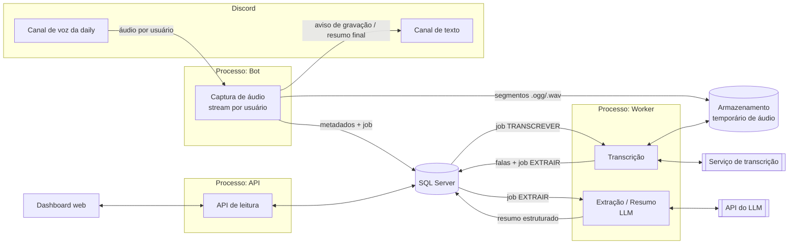

# BotMRX — Arquitetura

> Bot que grava as dailies do Discord, transcreve, identifica quem falou e gera um resumo
> estruturado por pessoa. O gestor consulta as dailies de qualquer dia (ou conjunto de dias)
> num dashboard.
>
> **Fora do escopo:** avaliação de desempenho, métricas de esforço, ranking ou score por pessoa.

Este documento é **agnóstico de framework**. Ele define módulos, responsabilidades, contratos
e dados, para que a implementação possa ser feita (ou migrada) para o framework da empresa
sem mudar o desenho.

---

## 1. Visão geral



### Princípios

1. **Identificação de quem falou sem diarização.** O Discord entrega o áudio separado por
   usuário. Cada trecho já chega com o `discordUserId` de quem falou.
2. **Pipeline assíncrono por estágios.** Captura, transcrição e extração são etapas separadas,
   ligadas por uma fila de jobs. Se uma etapa falhar, ela é reprocessada sem regravar a daily.
3. **Fila no próprio SQL Server.** A fila é uma tabela `Jobs` consumida com
   `UPDLOCK, READPAST`. Assim não entra RabbitMQ, Redis ou outra infraestrutura nova. Se
   vocês já tiverem uma fila corporativa, basta trocar o adaptador.
4. **Portas e adaptadores.** O domínio e os casos de uso não conhecem Discord, Whisper, Claude
   nem SQL Server. Cada serviço externo fica atrás de uma interface (seção 4).
5. **Rastreabilidade.** Todo item do resumo aponta para as falas que o originaram. No
   dashboard, clicar num item leva ao trecho da transcrição. Isso também reduz alucinação do
   LLM, porque o resumo pode ser conferido.
6. **Privacidade por padrão.** O áudio é temporário e é apagado depois da transcrição. Fica só
   o texto. Há aviso de gravação e opção de não ser gravado (opt-out).

---

## 2. Módulos

| # | Módulo | Processo | Responsabilidade |
|---|--------|----------|------------------|
| M1 | **Captura** | Bot | Entrar no canal de voz, avisar no canal de texto, receber o áudio por usuário, cortar em segmentos por silêncio, salvar os segmentos e registrar a daily. |
| M2 | **Armazenamento de áudio** | Bot / Worker | Guardar os segmentos até serem transcritos e depois apagar. Pode ser disco local, compartilhamento de rede ou blob storage. |
| M3 | **Fila de jobs** | Todos | Enfileirar, reservar, concluir e falhar jobs, com retry e backoff (tabela `Jobs`). |
| M4 | **Transcrição** | Worker | Transcrever cada segmento, juntar segmentos curtos da mesma pessoa e gravar `Falas`. |
| M5 | **Extração** | Worker | Montar a transcrição cronológica, chamar o LLM com saída estruturada (JSON Schema), validar e gravar o resumo e os itens. Também reconcilia os bloqueios em aberto. |
| M6 | **API de leitura** | API | Expor dailies, resumos, transcrições, histórico por pessoa, bloqueios e busca. |
| M7 | **Dashboard** | Web | Interface do gestor (seção 7). |
| M8 | **Administração** | API / Bot | Cadastro de times, canais e participantes, opt-out e reprocessamento. |

### Processos em execução

- **Bot**: uma instância por servidor Discord, porque uma conexão de voz por guild não pode
  ser duplicada. Não escala horizontalmente.
- **Worker**: pode ter N instâncias, porque a fila usa `READPAST`.
- **API**: stateless, pode ter N instâncias.
- **Dashboard**: estático ou SSR, conforme o framework.

> Num primeiro momento, Worker e API podem rodar no mesmo processo. Já o Bot deve ficar
> separado, porque ele precisa estar sempre conectado.

---

## 3. Fluxo de uma daily

### 3.1 Estados da daily

```
GRAVANDO → AGUARDANDO_TRANSCRICAO → TRANSCREVENDO → AGUARDANDO_EXTRACAO → EXTRAINDO → CONCLUIDA
                     ↘                     ↘                     ↘              ↘
                                         ERRO (com mensagem; pode ser reprocessada)
```

### 3.2 Passo a passo

1. **Início**
   - Manual: comando `/daily iniciar` no canal de voz.
   - Automático (opcional): a agenda do time (ex.: seg–sex 09:30) faz o bot entrar quando
     houver pelo menos 2 pessoas no canal configurado.
   - O bot posta no canal de texto: *"🔴 Esta daily está sendo gravada para gerar o resumo.
     Quem não quiser ser gravado: `/daily nao-gravar`."*
   - Cria a `Daily` com status `GRAVANDO`.

2. **Captura**
   - Para cada usuário que fala, o bot assina o stream de áudio daquele usuário.
   - Usuários com opt-out (`Participantes.NaoGravar = 1`) **não são assinados**: o áudio
     deles nunca é gravado.
   - Cada trecho contínuo de fala, cortado por silêncio de cerca de 1 s, vira um
     `SegmentoAudio` com `InicioMs` e `FimMs` relativos ao início da daily.
   - Registra entrada e saída de participantes no canal (`DailyParticipantes`).

3. **Encerramento**
   - Gatilho: `/daily encerrar`, o canal esvaziar ou um tempo máximo configurável.
   - O bot sai do canal, marca a daily como `AGUARDANDO_TRANSCRICAO` e enfileira o job
     `TRANSCREVER`.

4. **Transcrição (M4)**
   - Transcreve cada segmento. Pode ser em paralelo, com um limite de concorrência.
   - Junta segmentos consecutivos da mesma pessoa com intervalo menor que 1,5 s numa única
     `Fala`.
   - Grava as `Falas`, apaga os arquivos de áudio (`SegmentosAudio.ApagadoEm`), marca a daily
     como `AGUARDANDO_EXTRACAO` e enfileira o job `EXTRAIR`.

5. **Extração (M5)**
   - Monta a entrada do LLM:
     - a lista de participantes (id interno e nome);
     - a transcrição em ordem cronológica, no formato `[F123 | 00:01:23 | Fulano] texto`;
     - os bloqueios em aberto do time (id e descrição), para o LLM dizer quais continuam e
       quais foram resolvidos.
   - Chama o LLM com saída estruturada (`contracts/resumo-daily.schema.json`).
   - Valida o JSON: ids de falas e participantes precisam existir. Itens com referência
     inválida são descartados e registrados em log.
   - Grava o JSON bruto em `ExtracoesLlm`, para auditoria e reprocessamento.
   - Grava `ItensResumo`, `ItensResumoEvidencias` e cria ou atualiza `Bloqueios`.
   - Marca a daily como `CONCLUIDA`.
   - Opcional: posta um resumo curto no canal de texto com o link do dashboard.

### 3.3 Reprocessamento

- Reextrair (por exemplo, depois de melhorar o prompt) apaga os itens daquela daily e enfileira
  `EXTRAIR` de novo. A transcrição é mantida.
- Cada extração registra `Modelo` e `VersaoPrompt`, o que permite comparar versões.

---

## 4. Portas (interfaces)

São os contratos que o framework escolhido precisa implementar. Os nomes estão em português;
as assinaturas estão em pseudocódigo.

```text
// ---------- Captura ----------
FonteDeVoz
  conectar(guildId, canalVozId) -> SessaoDeVoz
  SessaoDeVoz.aoFalar(callback(discordUserId, streamDeAudio))
  SessaoDeVoz.aoEntrar(callback(discordUserId, quando))
  SessaoDeVoz.aoSair(callback(discordUserId, quando))
  SessaoDeVoz.desconectar()

Notificador
  postar(canalTextoId, mensagem)

// ---------- Áudio ----------
ArmazenamentoDeAudio
  salvar(dailyId, segmentoId, bytes, formato) -> caminho
  ler(caminho) -> bytes
  apagar(caminho)

// ---------- Transcrição ----------
Transcritor
  transcrever(bytes, formato, idioma="pt") -> { texto, confianca? }

// ---------- LLM ----------
ExtratorDeResumo
  extrair(EntradaExtracao) -> { resumo: ResumoDaily (JSON do contrato), modelo, versaoPrompt, bruto }

// ---------- Fila ----------
FilaDeJobs
  enfileirar(tipo, dailyId, executarApos?)
  reservarProximo(tipos[], workerId, duracaoReserva) -> Job | nulo
  concluir(jobId)
  falhar(jobId, erro)         // aplica backoff; depois de N tentativas vai para FALHOU

// ---------- Repositórios ----------
RepositorioDailies, RepositorioParticipantes, RepositorioFalas,
RepositorioResumo, RepositorioBloqueios, RepositorioTimes
```

### Adaptadores de referência

| Porta | Implementação inicial | Alternativas |
|-------|-----------------------|--------------|
| FonteDeVoz / Notificador | discord.js + @discordjs/voice (Node) | py-cord / discord.py com sinks (Python) |
| ArmazenamentoDeAudio | Disco local (volume Docker) | Azure Blob, S3, compartilhamento SMB |
| Transcritor | API Whisper/Deepgram/AssemblyAI | Whisper self-hosted (faster-whisper) se o áudio não puder sair da rede |
| ExtratorDeResumo | API do Claude com saída estruturada | — |
| FilaDeJobs | Tabela `Jobs` no SQL Server | Fila corporativa (Service Bus, RabbitMQ) |
| Repositórios | SQL Server | — |

> **Por que a captura fica em Node ou Python mesmo que o resto vá para outro framework:** o
> recebimento de voz do Discord só é bem suportado nas bibliotecas dessas linguagens. Se o
> framework da empresa for .NET ou Java, o desenho recomendado é **manter o Bot como um
> serviço pequeno em Node** e migrar Worker, API e Dashboard. Os dois lados conversam só pelo
> banco (Daily, SegmentosAudio, Jobs) e pelo armazenamento de áudio.

---

## 5. Modelo de dados (SQL Server)

O DDL completo está em [`db/schema.sql`](../db/schema.sql).

```
Times ─┬─< Dailies ─┬─< DailyParticipantes >── Participantes
       │            ├─< SegmentosAudio (temporário)
       │            ├─< Falas  ←───────────────┐
       │            ├─< ItensResumo ─< ItensResumoEvidencias
       │            ├─< ExtracoesLlm
       │            └─< Jobs
       └─< Bloqueios ─< ItensResumo (Tipo = BLOQUEIO)
```

| Tabela | Conteúdo |
|--------|----------|
| `Times` | Time, guild e canais de voz e texto, agenda da daily. |
| `Participantes` | Pessoa (id do Discord, nome de exibição, opt-out). |
| `Dailies` | Uma reunião: data, horários, status, resumo geral. |
| `DailyParticipantes` | Quem esteve presente e quando entrou ou saiu. |
| `SegmentosAudio` | Trechos de áudio aguardando transcrição. São apagados depois. |
| `Falas` | Transcrição: quem falou, quando e o quê. Tem índice full-text. |
| `ItensResumo` | Itens extraídos: `FEZ`, `VAI_FAZER`, `BLOQUEIO`, `DECISAO`, `PENDENCIA`. |
| `ItensResumoEvidencias` | Liga cada item às falas que o justificam. |
| `Bloqueios` | Bloqueio que atravessa várias dailies (`ABERTO` ou `RESOLVIDO`). |
| `ExtracoesLlm` | JSON bruto devolvido pelo LLM, modelo e versão do prompt. |
| `Jobs` | Fila de processamento. |

**Convenções:**
- Datas e horas em UTC (`DATETIME2(3)`).
- A coluna `Dailies.Data` (`DATE`) usa o fuso do time. É a coluna usada para filtrar "dia X".
- Textos em `NVARCHAR`.
- Chaves `BIGINT IDENTITY`.

---

## 6. API de leitura (M6)

Contratos detalhados em [`CONTRATOS.md`](CONTRATOS.md).

| Método | Rota | Uso no dashboard |
|--------|------|------------------|
| GET | `/times` | Seletor de time |
| GET | `/dailies?timeId=&datas=2026-11-10,2026-11-12` ou `&de=&ate=` | Lista e seletor de dias X, Y, Z |
| GET | `/dailies/{id}` | Resumo do dia: geral, cards por pessoa, decisões e pendências |
| GET | `/dailies/{id}/transcricao` | Transcrição completa |
| GET | `/dailies/comparar?ids=1,2,3` | Dailies lado a lado |
| GET | `/participantes/{id}/historico?datas=` ou `&de=&ate=` | O que a pessoa reportou nos dias escolhidos |
| GET | `/bloqueios?timeId=&status=ABERTO` | Painel de bloqueios em aberto |
| GET | `/busca?q=&timeId=&de=&ate=` | Busca full-text nas falas |
| POST | `/perguntas` | (Fase 3) Pergunta livre sobre um período, com resposta citando as falas |
| POST | `/admin/dailies/{id}/reprocessar` | Reextrair ou retranscrever |
| PUT | `/admin/participantes/{id}` | Nome e opt-out |

**Autenticação:** login com Discord (OAuth2). O acesso é liberado por role do Discord
configurada no time (ex.: `Gestor`). Também dá para trocar pelo SSO da empresa (Azure AD /
Entra ID), se o framework já tiver.

---

## 7. Dashboard (M7)

1. **Calendário / seletor de dias.** Marca os dias que têm daily. O gestor pode selecionar
   dias avulsos (X, Y, Z) ou um intervalo.
2. **Visão do dia.**
   - Resumo geral, decisões e pendências.
   - Um card por pessoa com **Fez / Vai fazer / Bloqueios**.
   - Clicar num item abre a transcrição no trecho de origem.
3. **Comparar dias.** Colunas lado a lado, uma por dia selecionado, com os cards alinhados por
   pessoa.
4. **Visão por pessoa.** Linha do tempo do que a pessoa reportou nos dias selecionados.
   Mostra apenas o que foi dito, sem notas ou métricas.
5. **Bloqueios em aberto.** O que foi citado como bloqueio, desde quando e em quais dailies
   apareceu.
6. **Busca.** Texto livre nas transcrições, com filtro por período e pessoa.

---

## 8. Uso do LLM

- **Uma chamada por daily.** Uma daily de 15 a 30 minutos cabe com folga no contexto, então
  não há necessidade de chunking.
- **Saída estruturada.** A resposta é validada contra o JSON Schema
  `contracts/resumo-daily.schema.json`. Não se faz parsing de texto livre.
- **Prompt versionado** em `prompts/extracao-daily.md`. A versão fica gravada em cada extração.
- **Regras do prompt:**
  - Só registrar o que foi dito.
  - Não inferir nem avaliar desempenho.
  - Todo item cita os ids das falas.
  - Quem não falou fica com listas vazias.
- **Modelo configurável por variável de ambiente.** O padrão de referência é `claude-opus-5-5`
  com `effort` explícito. Para uma tarefa de extração, `medium` ou `low` costumam bastar;
  confirme com algumas dailies reais.
- **Tratamento de recusa e erro.** Checar `stop_reason` antes de ler o conteúdo. Em caso de
  falha, o job entra em retry com backoff e, depois de N tentativas, a daily vai para `ERRO`
  e o problema aparece no dashboard.

---

## 9. Segurança e privacidade (LGPD)

- **Transparência.** Mensagem automática quando o bot entra na call e política escrita
  comunicada ao time.
- **Opt-out.** `/daily nao-gravar` faz o bot não assinar o áudio da pessoa. Ela aparece no
  dashboard como "presente, não gravado".
- **Minimização.**
  - O áudio é apagado logo depois da transcrição.
  - As transcrições ficam por um período configurável (`RETENCAO_TRANSCRICAO_DIAS`) e um job
    diário remove o que passou do prazo.
- **Acesso.** Dashboard restrito por role. A API não expõe dados de times que o usuário não
  pode ver.
- **Terceiros.** O áudio vai para o serviço de transcrição e o texto vai para o LLM. Confirme
  os termos de retenção desses provedores. Se o áudio não puder sair da rede, use Whisper
  self-hosted.
- **Segredos.** Token do bot, chaves de API e connection string ficam em variáveis de
  ambiente ou cofre, nunca no repositório.

---

## 10. Configuração (variáveis de ambiente)

```
# Discord
DISCORD_BOT_TOKEN=
DISCORD_CLIENT_ID=
DISCORD_CLIENT_SECRET=          # OAuth do dashboard

# Banco
SQLSERVER_CONNECTION_STRING=

# Áudio
AUDIO_STORAGE_PATH=/data/audio
SEGMENTO_SILENCIO_MS=1000
DAILY_DURACAO_MAXIMA_MIN=60

# Transcrição
TRANSCRICAO_PROVEDOR=whisper|deepgram|assemblyai|local
TRANSCRICAO_API_KEY=
TRANSCRICAO_CONCORRENCIA=4

# LLM
ANTHROPIC_API_KEY=
LLM_MODELO=claude-opus-5-5
LLM_EFFORT=medium

# Retenção
RETENCAO_TRANSCRICAO_DIAS=180

# Worker
JOB_MAX_TENTATIVAS=5
JOB_RESERVA_MIN=10
```

---

## 11. Riscos técnicos a validar primeiro (spike)

1. **Recebimento de voz no Discord.** O Discord não documenta oficialmente o recebimento de
   áudio por bots, mas as bibliotecas suportam. Além disso, o Discord vem adotando
   criptografia ponta a ponta na voz (protocolo **DAVE**). É preciso confirmar que a versão da
   biblioteca usada suporta DAVE **para receber áudio**. Este é o primeiro teste a fazer.
2. **Qualidade da transcrição em português** com o jargão do time (nomes de sistemas, siglas).
   Os provedores aceitam vocabulário customizado ou prompt de contexto, o que ajuda a reduzir
   erros.
3. **Segmentos muito curtos** ("ok", "sim") geram ruído. Defina uma duração mínima e junte
   segmentos próximos.

---

## 12. Roadmap

| Fase | Entrega |
|------|---------|
| **0 — Spike** | Bot entra na call, grava os streams por usuário e salva os arquivos. Valida o risco 1. |
| **1 — MVP** | Pipeline completo (captura → transcrição → extração) e resumo postado no canal de texto. Banco com Dailies, Falas e ItensResumo. |
| **2 — Dashboard** | Login, calendário, visão do dia, comparação de dias, visão por pessoa, busca. |
| **3 — Continuidade** | Bloqueios entre dailies, perguntas livres sobre um período, reprocessamento pelo painel. |

---

## 13. Estrutura de código sugerida (independente de framework)

```
botmrx/
├── docs/                    # este documento, contratos, decisões
├── db/                      # DDL e migrações do SQL Server
├── contracts/               # JSON Schemas compartilhados entre os serviços
├── prompts/                 # prompts versionados
├── bot/                     # serviço de captura (Node ou Python)
│   ├── dominio/
│   ├── aplicacao/           # IniciarDaily, EncerrarDaily, RegistrarSegmento
│   ├── portas/
│   └── adaptadores/         # discord, armazenamento, sqlserver
├── worker/                  # transcrição e extração
│   ├── aplicacao/           # TranscreverDaily, ExtrairResumo, ReconciliarBloqueios, LimparRetencao
│   ├── portas/
│   └── adaptadores/         # transcritor, llm, sqlserver, armazenamento
├── api/                     # API de leitura e administração
└── web/                     # dashboard
```

Ao migrar para o framework da empresa, as pastas `dominio/`, `aplicacao/` e `portas/` são
traduzidas quase uma para uma. Só os `adaptadores/` são reescritos.
